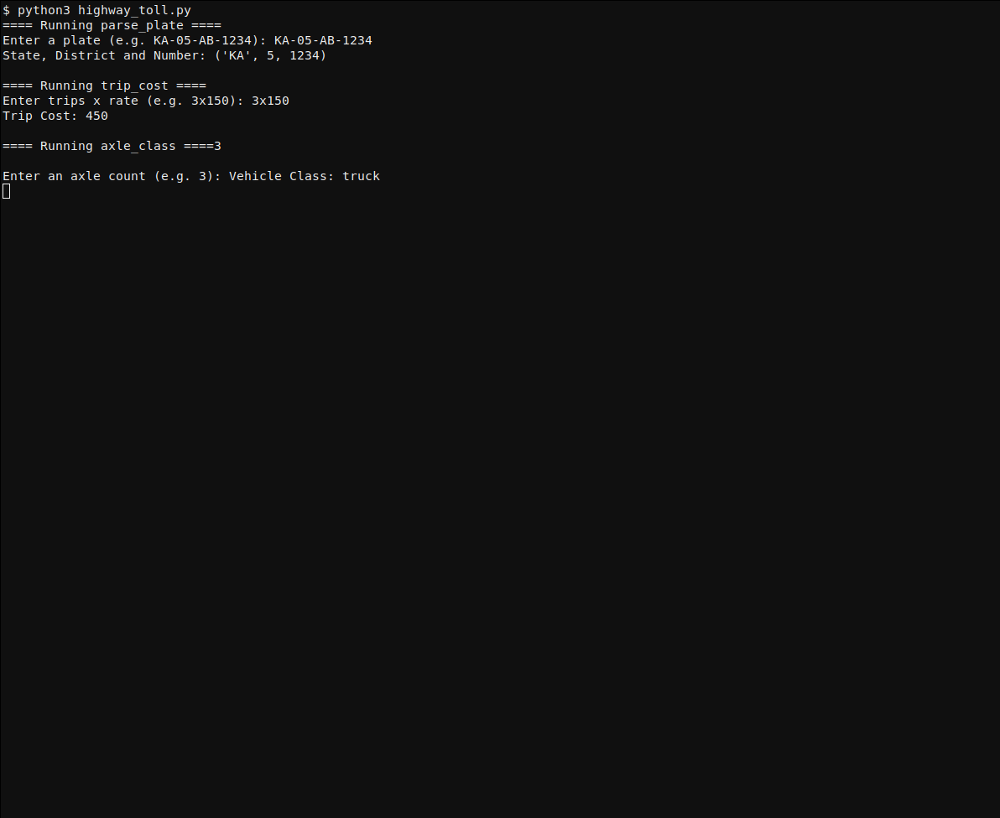
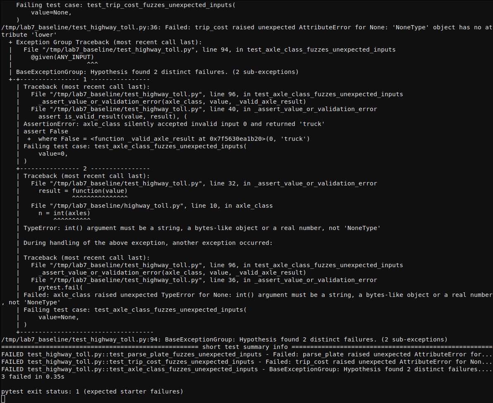
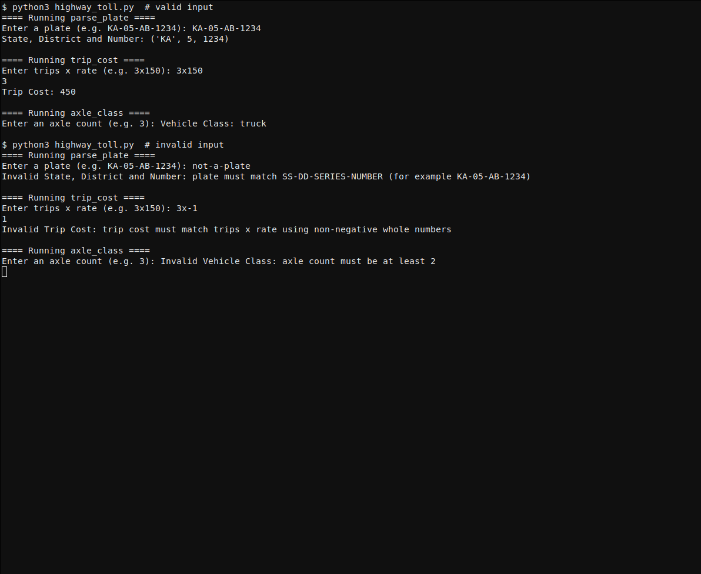
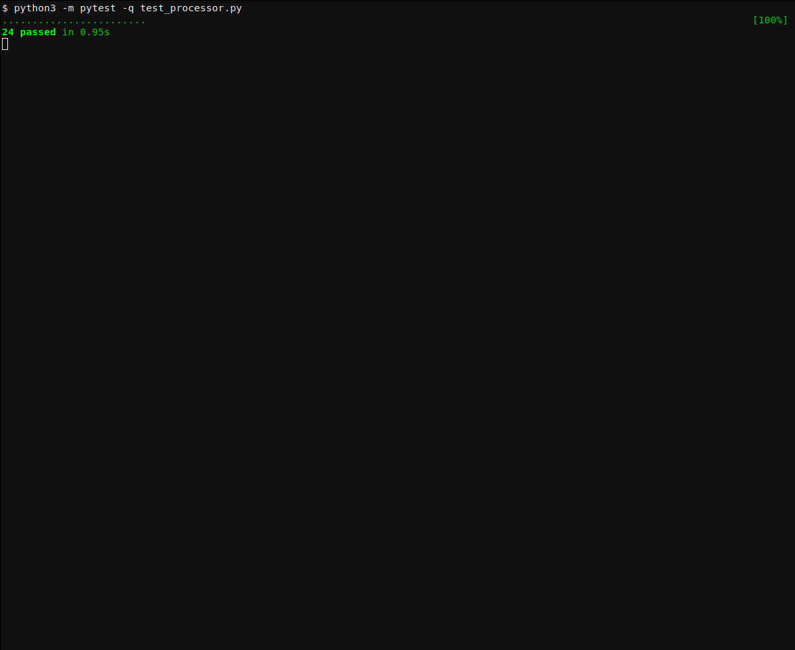

# Lab 7 — Fuzz Testing for Input Validation Bugs

**Student SRN:** PES2UG24CS165  
**Project:** L6_L7_36 — Highway Toll Calculator  
**Repository:** `SETAPESU26/L6_L7_36_highway_toll`  
**Lab files:** `highway_toll.py`, `test_highway_toll.py`, and `test_processor.py`

> The handout uses generic names such as `processor.py`; this repository provides the corresponding highway toll module. The repository's original test file is `test_highway_toll.py`; an identical `test_processor.py` is also included to match the handout's requested deliverable name.

## Objective

Use Hypothesis property-based fuzzing to uncover input-validation bugs in `parse_plate`, `trip_cost`, and `axle_class`, harden the implementation, and verify the corrected behavior.

## Bugs exposed by the starter tests

The initial fuzz run produced **14 failures and 10 passes**. Hypothesis reduced failures to small, useful examples:

- `parse_plate(None)` and `trip_cost(None)` raised uncaught `AttributeError` exceptions.
- `axle_class(None)` raised an uncaught `TypeError`.
- `axle_class(0)` silently returned `truck`; counts below two, including negative values, were not rejected.
- `parse_plate` accepted malformed state/district fields and district `00`.
- `trip_cost` accepted a negative count, which could produce a negative toll total.
- Float-like axle values could be truncated by `int()` rather than rejected.

## Changes made

- Added explicit type, format, and range validation to all three functions. Invalid input now raises a descriptive `ValueError` instead of leaking incidental exceptions.
- Validated the complete plate structure, including a two-letter state, district `01–99`, alphabetic series, and numeric registration number.
- Limited trip expressions to non-negative whole numbers separated by `x` or `X`.
- Required axle counts to be whole numbers of at least two; booleans and floats are rejected. Valid categories remain `2 → car`, `3–4 → truck`, and `5+ → heavy`.
- Updated the interactive application to display validation feedback and continue to the next prompt.
- Added Hypothesis properties for arbitrary inputs and generated valid examples, plus targeted regression tests.

## Verification

The updated test module reports **24 passed**. It performs 300 generated arbitrary-input examples for each fuzz property and 100 generated valid examples for each function, in addition to targeted regression cases. The application was also run with valid and malformed input sequences.

Reproduce from the `lab7` directory:

```bash
python3 -m pip install -r requirements.txt
python3 highway_toll.py
python3 -m pytest -q test_processor.py
```

## Genuine terminal screenshots

Each image below is a **direct screenshot of the actual xterm window** while the command or application was running. The PNGs were captured from the desktop display; no terminal image was composed from text.

### Step 2 — starter application output



### Steps 3–4 — initial Hypothesis failures



### Step 5 — fixed application output

Valid output is shown first, followed by malformed inputs handled with readable validation messages.



### Step 6 — rerun using the requested test_processor.py name



## Deliverables

- Fixed application: `highway_toll.py`
- Updated repository test module: `test_highway_toll.py`
- Updated handout-named test file: `test_processor.py`
- Test dependencies: `requirements.txt`
- This report and genuine terminal screenshot evidence
